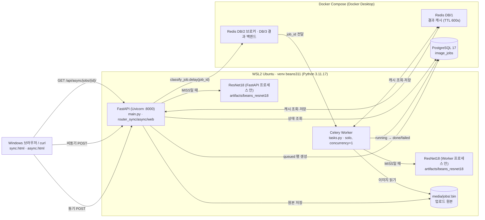

# 02. 전체 시스템 아키텍처 설계서

> 실제로 실행한 구조를 기준으로 작성했다. **Docker 컨테이너는 Redis·PostgreSQL 두 개뿐**이고, FastAPI·Celery는 WSL2 Python 가상환경에서 실행했다(평가가이드 3장 방식). 02 교재의 `compose.yaml`에는 `web`·`worker` 서비스도 있지만, `docker compose up -d redis postgres`로 두 서비스만 실행했다.

## 1. 구성도

## 2. 컴포넌트 역할

| 컴포넌트 | 실행 위치 | 사용 파일 / 서비스 | 역할 |
|---|---|---|---|
| 브라우저 | Windows | `templates/sync.html`, `async.html`, `static/style.css` | 업로드, 결과 표시, 비동기 1초 간격 폴링 |
| FastAPI | WSL2 venv, 터미널 3 | `main.py`, `ai/router_sync.py`, `router_async.py`, `router_web.py` | HTTP 요청 검증·응답, 시작할 때 `init_db()`로 테이블 생성 |
| 이미지 검증 | FastAPI·Worker 공통 | `ai/services.py` `load_rgb_image()` | 5MB, JPEG/PNG/WEBP, 1,200만 픽셀 제한 |
| ResNet18 | **FastAPI와 Worker에 각각 1개씩 로드** | `ai/hf_model.py` (`lru_cache`, `device=-1` = CPU) | 3클래스 분류 |
| Redis Cache | Docker Redis **DB/1** | `ai/cache_service.py` | 키 `vision:classify:<모델경로 해시 16자>:<이미지 SHA256>`, TTL 600초 |
| Redis Broker | Docker Redis **DB/2** (결과는 DB/3) | `ai/celery_app.py` | Celery 작업 메시지 전달 |
| PostgreSQL | Docker | `ai/database.py`, `ai/models.py` | `image_jobs`: 비동기 작업 상태·결과 |
| Celery Worker | WSL2 venv, 터미널 2 | `ai/tasks.py` `classify_job()` | 비동기 추론, DB 갱신 |
| 업로드 원본 | WSL2 (Windows 폴더) | `media/jobs/` | DB에는 파일명만 저장 |

## 3. 실행환경 (실제 값)

| 항목 | 값 |
|---|---|
| OS | Windows + WSL2 (커널 `6.18.54.1-microsoft-standard-WSL2`) |
| Python | 3.11.17 (conda로 3.11을 만들고 `~/venvs/beans311` venv 생성) |
| 주요 패키지 | torch 2.15.0+cu132, transformers 4.57.6, celery 5.6.3 |
| GPU | NVIDIA RTX 3060 12GB — **학습에만 사용**. 서빙은 `hf_model.py`의 `device=-1` 그대로 CPU 추론 |
| Docker 서비스 | `redis:7.4-alpine`, `postgres:17-alpine` (둘 다 `healthy`, `reports/evidence/cli/01_compose_ps.txt`) |
| 서버 | `uvicorn main:app --host 127.0.0.1 --port 8000` |
| 워커 | `celery -A ai.celery_app:celery_app worker --loglevel=info --pool=solo --concurrency=1` |
| 모델 경로 | `.env` `MODEL_PATH=artifacts/beans_resnet18` |
| 접속 주소 | `ai/config.py` 기본값 `127.0.0.1` 사용 (컨테이너가 포트 5432·6379를 127.0.0.1에만 공개) |
| 프로젝트 위치 | `C:\Users\user1\ai_vision\beans_eval\fastapi_resnet18` (WSL `~/fastapi_resnet18` 심볼릭 링크) |

## 4. 구조 검증 결과

| 흐름 | 경로 | 근거 |
|---|---|---|
| 동기 MISS | 브라우저 → FastAPI → Redis DB/1(없음) → ResNet18 → Redis 저장 → 200 | `sync_rust.png` (`cache_hit:false`, `inference_ms:21.27`) |
| 동기 HIT | 브라우저 → FastAPI → Redis DB/1(있음) → 200 | `sync_rust_hit.png` (`cache_hit:true`, `inference_ms:null`, 7ms) |
| 비동기 | 브라우저 → FastAPI → `media/jobs` 저장 → PG `queued` → Redis DB/2 → Worker → PG `running` → `done` → 조회 | `cli/05_async_202.txt`, `cli/06_async_job_poll.txt` (running 4회 관찰 후 done) |
| 캐시 공유 | 동기로 분류한 healthy를 비동기로 다시 보내자 Worker가 캐시 HIT | `async_done_hit.png` (job 1, `cache_hit:true`) |
| 모델 이중 로드 | Worker의 첫 MISS 작업 `inference_ms` 3059.36 / 2624.61ms (모델 로딩 포함). 이후 16~21ms | `cli/14_db_rows.txt`, `data/timings.csv` |

- 동기 요청은 `image_jobs`에 기록되지 않는다 (제공 코드 설계). DB 행은 모두 비동기 작업이다.
