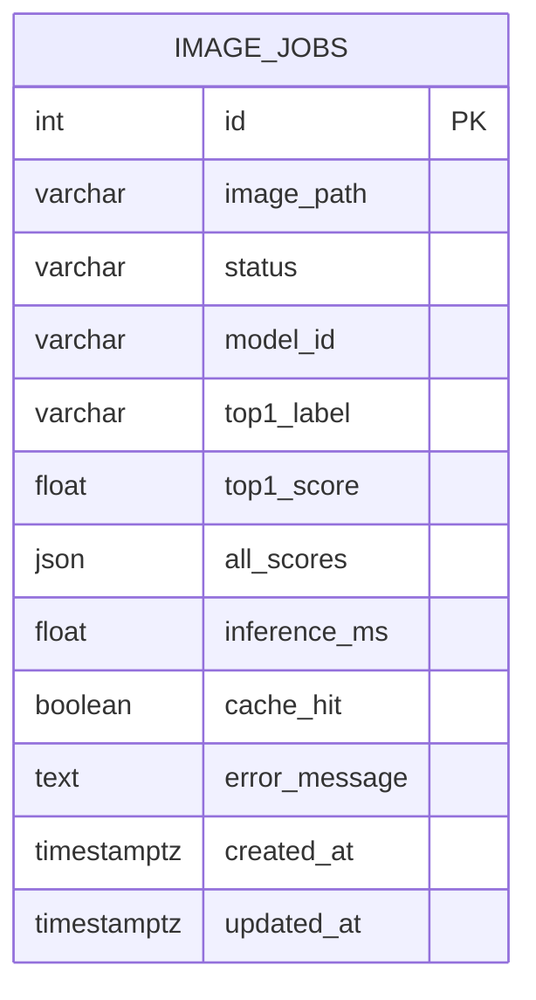
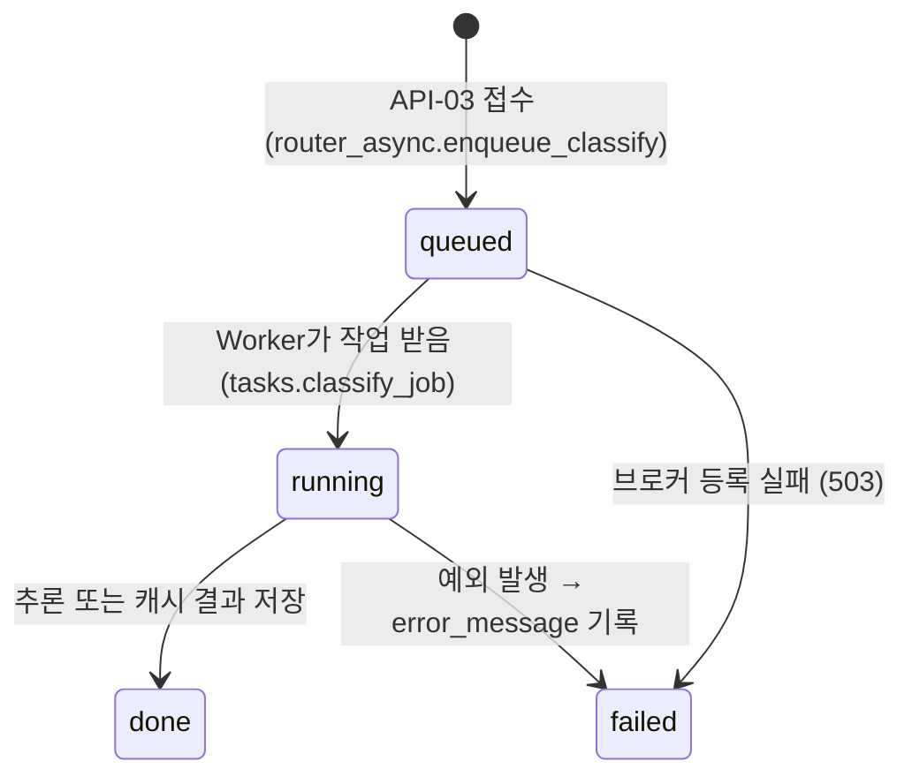

# 04. 데이터베이스 구조 및 작업이력

**테이블:** `image_jobs` (하나뿐) · **PK:** `id` · **저장 대상:** 비동기 추론 작업의 상태와 결과
**DB:** PostgreSQL 17 (Docker) `vision_db` / 사용자 `vision_user` · 테이블은 FastAPI가 시작할 때 `init_db()` → `Base.metadata.create_all()`로 만들어진다.

## 1. ERD



- 다른 테이블이나 FK는 없다. 이미지 원본도 DB에 넣지 않는다.

## 2. 컬럼 정의 (실제 `\d image_jobs` 결과 — `evidence/cli/13_db_schema.txt`)

| 컬럼 | DB 자료형 (실측) | Nullable | 예시 값 (실제) | 사용 이유 |
|---|---|---|---|---|
| id | integer, `nextval('image_jobs_id_seq')` | not null, **PK** | 2 | 작업번호 = API `job_id` |
| image_path | character varying(150) | not null | `a9bb07e6d9094afcbbf9d6cd583d8715.bin` | `media/jobs/` 안의 파일명 (사용자가 보낸 파일명은 쓰지 않음) |
| status | character varying(20) | not null, **인덱스** `ix_image_jobs_status` | `done` | 처리 상태 |
| model_id | character varying(255) | not null | `artifacts/beans_resnet18` | 어떤 모델로 처리했는지 |
| top1_label | character varying(200) | NULL 가능 | `bean_rust` | 최종 분류 |
| top1_score | double precision | NULL 가능 | 0.6051 | 분류 점수 |
| all_scores | json | NULL 가능 | `[{"label":"bean_rust","score":0.6051}, ...]` | 클래스별 점수 (API에서는 `all`) |
| inference_ms | double precision | NULL 가능 | 3059.36 | 실제 추론 시간. HIT이면 NULL |
| cache_hit | boolean | NULL 가능 | f | 캐시 재사용 여부 |
| error_message | text | NULL 가능 | NULL | 실패 원인 |
| created_at | timestamp with time zone | not null | `2026-11-04 02:51:37.684468+00` | 접수 시각 (UTC, 한국시간 11:51:37) |
| updated_at | timestamp with time zone | not null | `2026-11-04 02:51:40.77813+00` | 마지막 갱신 시각 |

- `status`·`model_id`의 기본값(`queued`, 빈 문자열)은 SQLAlchemy가 Python 쪽에서 넣는다. 그래서 DB 스키마의 Default 칸에는 나타나지 않는다.

## 3. SQL 조회

```sql
SELECT id, status, image_path, model_id, top1_label, round(top1_score::numeric,4) AS score,
       inference_ms, cache_hit, error_message, created_at, updated_at
FROM image_jobs ORDER BY id DESC LIMIT 10;
```

**결과 (11:51 기준, `evidence/cli/14_db_rows.txt`)**

| id | status | top1_label | score | inference_ms | cache_hit | 판정 |
|---:|---|---|---:|---:|---|---|
| 2 | done | bean_rust | 0.6051 | 3059.36 | f | 비동기 MISS 완료 (Worker 첫 모델 로딩 포함) |
| 1 | done | healthy | 0.6369 | NULL | t | 동기 요청이 남긴 캐시를 Worker가 재사용 |

**최종 상태 (15:43 조회, 전체 13건 — `evidence/cli/17_db_final.txt`, 시간은 KST)**

| id | status | top1_label | score | inference_ms | cache_hit | 접수 시각 | 접수→완료(ms) | 생긴 경위 |
|---:|---|---|---:|---:|---|---|---:|---|
| 1 | done | healthy | 0.6369 | NULL | t | 11:46:46 | 110 | 브라우저 비동기 (직전 동기 결과를 캐시에서 재사용) |
| 2 | done | bean_rust | 0.6051 | 3059.36 | f | 11:51:37 | 3094 | `collect_evidence.sh` MISS (Worker 첫 모델 로딩 포함) |
| 3 | done | angular_leaf_spot | 0.4623 | NULL | t | 11:52:21 | **26913** | Worker 정지 테스트: 꺼져 있는 동안 queued로 대기 → 재시작 직후 처리 |
| 4 | done | angular_leaf_spot | 0.5146 | 2624.61 | f | 11:55:44 | 2647 | 측정 MISS 1회차 (Worker 재시작 뒤 첫 모델 로딩) |
| 5 | done | angular_leaf_spot | 0.5146 | NULL | t | 11:55:47 | 14 | 측정 HIT |
| 6 | done | angular_leaf_spot | 0.3825 | 17.65 | f | 11:55:47 | 32 | 측정 MISS (정답은 bean_rust → **오답**) |
| 7 | done | angular_leaf_spot | 0.3825 | NULL | t | 11:55:48 | 10 | 측정 HIT |
| 8 | done | bean_rust | 0.5000 | 20.57 | f | 11:55:48 | 33 | 측정 MISS (정답은 healthy → **오답**) |
| 9 | done | bean_rust | 0.5000 | NULL | t | 11:55:48 | 10 | 측정 HIT |
| 10 | done | angular_leaf_spot | 0.5796 | 18.96 | f | 11:55:48 | 35 | 측정 MISS |
| 11 | done | angular_leaf_spot | 0.5796 | NULL | t | 11:55:49 | 9 | 측정 HIT |
| 12 | done | bean_rust | 0.5911 | 16.65 | f | 11:55:49 | 31 | 측정 MISS |
| 13 | done | bean_rust | 0.5911 | NULL | t | 11:55:49 | 9 | 측정 HIT |

- `접수→완료(ms)` = `updated_at - created_at`이다. Worker 쪽 처리 시간이며, 클라이언트가 잰 최종 확인 시간(폴링 포함)과는 다르다.
- **상태별 개수:** `done` 13건 / `failed` **미발생** / 오류 메시지 0건
- **캐시별:** MISS(f) 6건 — 추론 평균 959.63ms. 콜드스타트 2건(3059·2624ms) 때문에 평균이 커졌고, 나머지 4건은 16.65~20.57ms다. HIT(t) 7건 — `inference_ms` 전부 NULL
- **업로드 원본:** `media/jobs/*.bin` **13개** = DB 행 13건 (1:1 대응)
- 같은 이미지의 MISS·HIT 쌍(4·5, 6·7, …)은 점수가 완전히 같다 → 캐시가 저장된 결과를 그대로 돌려준다는 근거
- DB 연동 판정: 비동기 작업 13건이 모두 PostgreSQL에 queued → done으로 기록됐고, 파일 저장과도 일치한다 → **정상**

## 4. 상태 전이



| 전이 | 실제 관찰 | 근거 |
|---|---|---|
| queued | ✅ 접수 응답, Worker 정지 중 job 3 | `cli/05_async_202.txt`, `async_worker_stopped_queued.png` |
| running | ✅ job 2 폴링 1~4회째 | `cli/06_async_job_poll.txt` |
| done | ✅ 13건 전부 | `cli/17_db_final.txt` |
| failed | **미발생** (실환경). 모의 테스트 `test_worker_failure_records_failed`에만 있음 | — |

## 5. 저장 방식 정리
- 이미지 원본은 `media/jobs/<uuid>.bin`에 따로 저장한다. DB에는 파일명만 넣는다 (11:51 기준 2개 → 최종 13개 = DB 13행, `cli/16_media_jobs.txt`, `cli/17_db_final.txt`).
- **동기 요청은 DB에 행을 만들지 않는다** (제공 코드 설계). 동기로 수십 번 요청했지만 DB 행은 모두 비동기 작업이다.
- Redis 캐시(DB/1)는 TTL이 600초라 DB처럼 오래 남는 기록이 아니다. 오래 남는 작업 이력은 PostgreSQL에만 있다.
