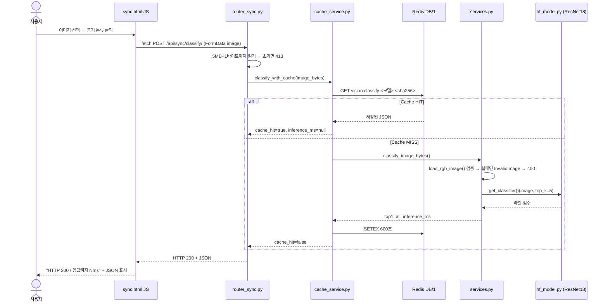
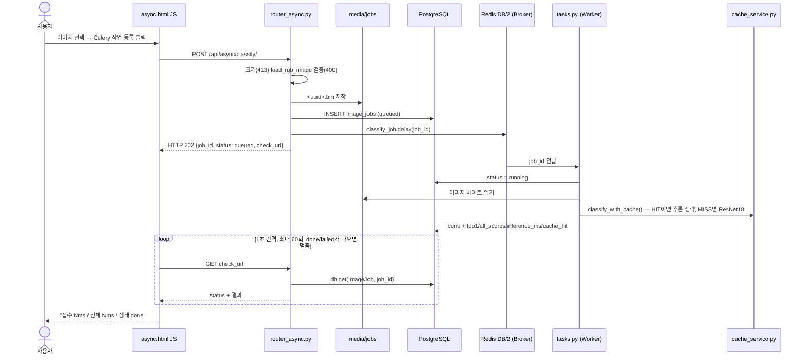

# 05. AI 분석 버튼 처리 파이프라인

## A. 동기 버튼 ("동기 분류") 클릭 시퀀스

## B. 비동기 버튼 ("Celery 작업 등록") 클릭 시퀀스

## C. 실제 코드 연결표

| 단계 | 파일 | 함수·처리 | 결과 / 다음 단계 |
|---|---|---|---|
| 동기 1 | `templates/sync.html` | `send.onclick` → `fetch('/api/sync/classify/')`, `performance.now()`로 시간 측정 | HTTP 상태와 ms 표시 |
| 동기 2 | `ai/router_sync.py` | `classify_sync()` — `image.file.read(MAX+1)`, 413 판정 | `classify_with_cache()` |
| 동기 3 | `ai/cache_service.py` | `classify_with_cache()` — `cache_key()`, `get`/`setex(600)`. Redis가 죽어 있으면 경고만 남기고 추론 진행 | HIT 결과 또는 `classify_image_bytes()` |
| 동기 4 | `ai/services.py` | `load_rgb_image()` 검증 → `classify_image_bytes()` (`perf_counter`로 `inference_ms` 측정) | `top1`, `all` |
| 동기 5 | `ai/hf_model.py` | `get_classifier()` — `@lru_cache(maxsize=1)`, 프로세스마다 첫 호출 때 한 번만 로드 | HF `pipeline("image-classification")` |
| 비동기 1 | `templates/async.html` | `fetch('/api/async/classify/')` → `check_url` 폴링 루프 | 화면 갱신 |
| 비동기 2 | `ai/router_async.py` | `enqueue_classify()` — 검증, `media/jobs` 저장, `ImageJob(queued)`, `classify_job.delay()` (실패하면 `failed`+503) | 202 / job_id |
| 비동기 3 | `ai/tasks.py` | `classify_job(job_id)` — running → `classify_with_cache()` → done / 예외면 failed | DB 갱신 |
| 비동기 4 | `ai/router_async.py` | `get_job()` — 없으면 404, `done`일 때만 `top1`·`all` 반환 | 상태 JSON |

## D. 실행으로 확인한 점

| 확인 | 결과 | 증빙 |
|---|---|---|
| 동기는 응답 안에 결과가 들어 있다 | 200 + top1 (31~34ms) | `sync_*.png` |
| 비동기는 먼저 접수만 응답한다 | 202 + job_id=2 → 폴링으로 running → done | `cli/05`, `cli/06` |
| 동기와 비동기가 캐시를 함께 쓴다 | 동기로 분류한 healthy를 비동기로 보내면 `cache_hit:true` | `async_done_hit.png` |
| Worker가 꺼져 있어도 접수는 된다 | job 3 queued 유지 → 재시작 직후 done | `async_worker_stopped_queued.png`, `celery_worker.log` |
| `inference_ms`에 모델 로딩이 섞일 수 있다 | `get_classifier()` 첫 호출이 타이머 안에 있음 → Worker 첫 MISS 3059ms | `cli/14_db_rows.txt` |
| 화면의 "서버에서 추론 중..." 문구 | 응답이 수십 ms라 거의 보이지 않음 | — |

**비교 결론**
- 동기: HTTP 응답을 받는 순간 분류 결과가 이미 들어 있다.
- 비동기: 202로 접수만 받고, 결과는 따로 조회해야 한다.
- 분류에 쓰는 ResNet18 체크포인트는 같다. 다만 **각 프로세스가 모델을 따로 메모리에 올린다.**
